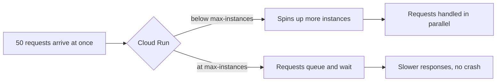

# 1. Scaling

## What Is It?

Imagine a single cashier at a shop. One customer at a time, no problem. Now fifty customers walk in at once — one cashier can't serve them all, so a line forms and people wait. Scaling is opening more checkout counters automatically when the crowd shows up, and closing them again once the crowd leaves.

Cloud Run does exactly this for ModeraAI: when requests pile up, it starts new copies (instances) of the service to handle them, all on its own. You don't provision servers — you just tell it the rules: how many instances at most, how many requests each one can juggle at once.

## Why It Matters for AI Engineers

AI calls are slow compared to a normal API — a Gemini call can take a second or more. If ten people hit ModeraAI in the same second and it can only truly process one at a time, nine of them sit waiting. Scaling is what turns "works in my demo" into "works when real traffic shows up," and it's the very first thing that breaks in an unprepared AI service, because AI calls are exactly the slow, expensive kind of work that queues up fastest.

## Key Concepts

| Term | Definition |
|---|---|
| Instance | One running copy of your container, able to handle requests |
| Concurrency | How many requests one instance will accept at the same time (Cloud Run default: 80) |
| `--max-instances` | The hard ceiling — Cloud Run will never start more instances than this |
| `--min-instances` | Instances kept warm even with zero traffic (avoids cold starts, costs money at rest) |
| Cold start | The delay when Cloud Run has to start a brand-new instance from nothing |
| Autoscaling | Cloud Run's automatic decision of how many instances to run right now, based on load |

## How It Fits Together



## Hands-On

**Console:** Cloud Run → `moderaai` service → **Metrics** tab → "Instance count" and "Request latency". These graphs lag by a few minutes, so use them to look back, not to watch live.

**CLI** (the full commands are in [`commands.md`](../commands.md), topic 1):

```bash
# Fire the load test: 50 requests at the same moment
uv run python scripts/load_test.py --url https://moderaai-1039893753206.us-central1.run.app --requests 50

# Make one instance take at most 5 requests at a time, so 50 requests need several instances
gcloud run services update moderaai --project=gcp-fde-project --region=us-central1 --concurrency=5 --quiet

# Cap the service at 2 instances
gcloud run services update moderaai --project=gcp-fde-project --region=us-central1 --max-instances=2 --quiet
```

## How We Test It

"Trust me, it scales" isn't good enough, so we count. `scripts/load_test.py` fires 50 `/moderate` requests at the same time and prints each one's status and time. Every request is logged with the ID of the instance that served it, so counting the different IDs tells you how many instances ran.

| Run | Settings | Instances that served the 50 requests |
|---|---|---|
| 1 | default (80 requests per instance) | **1**: one instance took them all, so nothing scaled |
| 2 | concurrency 5 | **10** |
| 3 | concurrency 5, max-instances 2 | **2**: the ceiling holds |

In run 3 only 10 requests fit at once (2 instances × 5). On our first run the rest waited their turn; on a later run Cloud Run turned 40 of them away straight away with HTTP **429** ("too many requests"). Either way, the ceiling is real: it limits your bill, and past it callers wait or are told to try again.

## Common Pitfalls

- Assuming autoscaling is unlimited — it always has a ceiling, whether you set one or Cloud Run's project-level default does
- Setting `--min-instances=0` everywhere and being surprised by cold-start latency on the very first request after idle time
- Forgetting that concurrency (requests per instance) and instance count (number of instances) are two separate dials — both affect how much traffic you can absorb
- Expecting a small load test to scale the service: with the default 80 requests per instance, 50 requests fit in one instance

## Quick Recap

1. What happens to the 51st request if `--max-instances` is already reached?
2. Why does an AI service tend to hit scaling limits faster than a typical CRUD API?
3. What's the difference between `--min-instances` and `--max-instances`?
