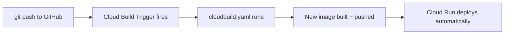

# 3. CI/CD

## What Is It?

CI/CD stands for Continuous Integration / Continuous Deployment. In plain words: instead of you manually running build-and-deploy commands every time you change code, you connect your GitHub repo to Cloud Build once, and from then on, every `git push` automatically triggers a build and a deploy — no human types a `gcloud` command ever again.

## Why It Matters for AI Engineers

AI services change often — a new prompt, a tweaked policy, a new model version. If shipping each change requires someone to remember five manual steps, changes ship slowly and inconsistently, and it's easy to forget a step under pressure. CI/CD makes "push code" and "it's live" the same action, which is what lets a team ship many small, safe changes instead of rare, risky big ones.

## Key Concepts

| Term | Definition |
|---|---|
| CI (Continuous Integration) | Automatically building/testing code on every change |
| CD (Continuous Deployment) | Automatically deploying that build if it succeeds |
| Trigger | The rule connecting "a push happened" to "run this build" |
| GitHub connection | A one-time authorization letting Cloud Build see your repo |

## How It Fits Together



## Hands-On

Everything is a command except one browser step (full commands in [`commands.md`](../commands.md), topic 3):

1. **Give Cloud Build access to Secret Manager.** It keeps GitHub's login token there.
2. **Connect GitHub** with `gcloud builds connections create github`. It prints a link: open it, sign in to GitHub, and install the Cloud Build GitHub App on the repo. This is the one step that can't be a command.
3. **Link the repo and create the trigger:**

```bash
gcloud builds triggers create github --name=moderaai-deploy-trigger --region=us-central1 --project=gcp-fde-project \
  --repository=projects/gcp-fde-project/locations/us-central1/connections/moderaai-github/repositories/cloud-eng-demo \
  --branch-pattern='^main$' \
  --build-config=moderaai/cloudbuild.yaml \
  --included-files='moderaai/**' \
  --service-account=projects/gcp-fde-project/serviceAccounts/1039893753206-compute@developer.gserviceaccount.com
```

The trigger watches the `main` branch of `d-hackmt/cloud-eng-demo`, and only changes inside `moderaai/`. A change to the docs deploys nothing.

## How We Test It

This is the one topic that must be tested with a **real commit** — no simulation makes sense here. Make a small change inside `moderaai/`, then push it:

```bash
date -u > moderaai/last-ci-test.txt
git add moderaai/last-ci-test.txt
git commit -m "test: trigger CI/CD"
git push origin main
```

Then watch Cloud Build → **History** in the Console (or `gcloud builds list --region=us-central1`). On our run the build started within seconds and finished in about 2.5 minutes, with no deploy command typed. `gcloud run revisions list` then shows a new revision that nobody deployed by hand.

## Common Pitfalls

- Expecting the trigger to fire instantly — there's a real webhook + queueing delay, usually under a minute but not zero
- Pushing to a branch that doesn't match the trigger's branch pattern and wondering why nothing happened
- Forgetting the trigger's `cloudbuild.yaml` path must match the file's actual path in the repo exactly
- A build that runs as a chosen service account is rejected instantly unless `cloudbuild.yaml` says where its logs go (`options: logging: CLOUD_LOGGING_ONLY`)
- The pipeline ships whatever is pushed: there are no tests between the push and the deploy

## Quick Recap

1. What's the difference between CI and CD?
2. What one-time step has to happen before pushes can trigger builds?
3. How do you prove a CI/CD pipeline actually works, rather than just trusting it's configured correctly?
