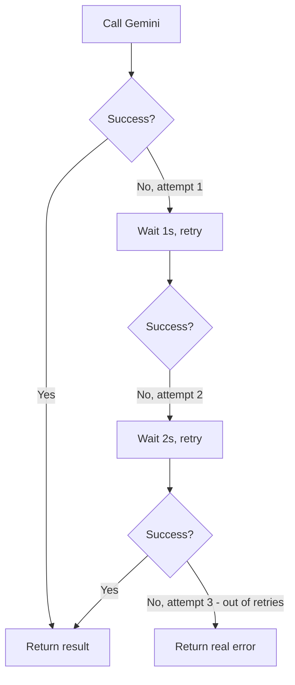

# 7. Retry Strategies

## What Is It?

If you call someone and the line drops, you don't give up forever — you call again. A retry strategy is ModeraAI doing that automatically: if a call to Gemini fails for a reason that's likely temporary (a network blip, a momentary overload), it tries again a couple of times before giving up, instead of failing the user's request on the very first hiccup.

## Why It Matters for AI Engineers

Calls to any external API — Gemini included — fail sometimes for reasons that have nothing to do with your code and go away on their own a second later. Without retries, a perfectly healthy service reports errors on a normal day just because of ordinary network noise. With retries, most of those failures become invisible to the caller — the system just quietly tries again and succeeds.

## Key Concepts

| Term | Definition |
|---|---|
| Transient failure | A temporary error likely to succeed if retried (vs. a permanent one that never will) |
| Exponential backoff | Waiting longer between each retry attempt (1s, then 2s, then 4s...) instead of hammering immediately |
| `tenacity` | The Python library used here to add retry behavior with a decorator |
| Max attempts | A hard cap so retries don't loop forever on a truly broken dependency |

## How It Fits Together



## Hands-On

```python
from tenacity import before_sleep_log, retry, stop_after_attempt, wait_exponential

# 3 attempts, waiting 1 s then 2 s; before_sleep_log writes one log line per retry
@retry(stop=stop_after_attempt(3), wait=wait_exponential(multiplier=1, min=1, max=8),
       before_sleep=before_sleep_log(logger, logging.WARNING))
def call_gemini(text):
    return client.models.generate_content(...)
```

## How We Test It

Make Gemini calls fail on purpose, without touching real users: deploy a temporary revision whose Gemini time limit is 1 ms (so every call times out), at 0% traffic with its own address, and call it. The commands are in [`commands.md`](../commands.md), topics 7 and 8 (one demo covers both).

The logs then show the retry strategy at work: two retries, after waiting 1 s and then 2 s, before the service gives up:

```bash
gcloud logging read 'resource.type=cloud_run_revision AND resource.labels.service_name=moderaai AND textPayload:"Retrying"' \
  --project=gcp-fde-project --limit=10 --freshness=15m --order=asc --format="value(timestamp,textPayload)"
# -> WARNING:moderaai:Retrying main.call_gemini in 1 seconds as it raised ConnectTimeout: ... The handshake operation timed out.
# -> WARNING:moderaai:Retrying main.call_gemini in 2 seconds as it raised ConnectTimeout: ... The handshake operation timed out.
```

Here every attempt fails, so the caller gets a clean error after the third one. With a real, brief hiccup, the second or third attempt succeeds and the caller just sees a slightly slower answer.

## Common Pitfalls

- Retrying *every* kind of failure, including permanent ones (like a malformed request) — that just wastes time before failing anyway
- No backoff (retrying instantly, back-to-back) — hammers an already-struggling dependency instead of giving it room to recover
- No max attempts — an infinite retry loop turns a transient failure into a hung request (this is exactly what topic 8, Timeouts, guards against)

## Quick Recap

1. What's the difference between a transient and a permanent failure, and why does that distinction matter for retries?
2. Why does the wait time increase between each retry attempt instead of staying constant?
3. If the first attempt fails but the second succeeds, what does the caller see?
