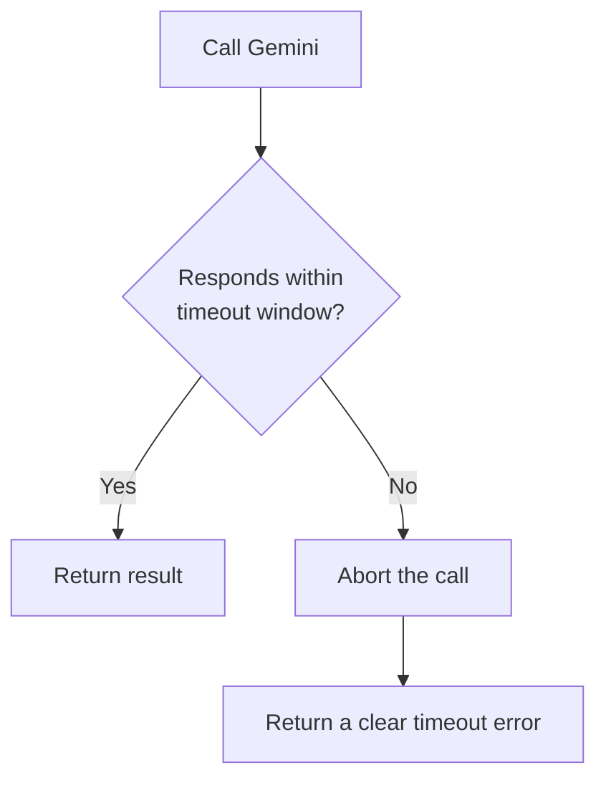

# 8. Timeouts

## What Is It?

If you ask someone a question and they just stand there silently, at some point you stop waiting and walk away rather than standing there forever. A timeout is ModeraAI doing that: if a call to Gemini takes too long, it gives up and returns a clear error, instead of leaving the caller hanging indefinitely.

## Why It Matters for AI Engineers

A hung request is worse than a failed one — it ties up an instance, a connection, and the caller's patience, all for an answer that may never come. Retries (topic 7) handle failures that happen *fast*; timeouts handle the failure that happens *slow* — the call that never technically errors, it just never finishes. Both are needed; neither replaces the other.

## Key Concepts

| Term | Definition |
|---|---|
| Client-side timeout | A limit set in the code calling Gemini (the `google-genai` SDK's `HttpOptions`) |
| Cloud Run request timeout | A platform-level ceiling on how long Cloud Run itself will wait for a response (configurable, default 300s) |
| Fail fast | The principle that a fast, clear failure is better than a slow, silent hang |

## How It Fits Together



## Hands-On

```python
from google.genai.types import HttpOptions

client = genai.Client(vertexai=True, http_options=HttpOptions(timeout=10000))  # 10s, in ms
```

```bash
# Cloud Run's own backstop timeout is set at deploy time: --timeout=30 (see topic 1's deploy)

# The built-in switch that sleeps for 60 seconds (needs ENABLE_DEMO_SWITCHES=true, like topic 7's switch)
curl -w "\nHTTP %{http_code} after %{time_total}s\n" -X POST "https://moderaai-1039893753206.us-central1.run.app/moderate?simulate_hang=true" \
  -H "Content-Type: application/json" -d '{"text": "timeout demo text"}'
```

## How We Test It

There are two safety nets, and each is tested on its own (full commands in [`commands.md`](../commands.md), topic 8):

1. **Cloud Run's timeout.** `?simulate_hang=true` sleeps for 60 seconds. On our run the request was cut off at **30.4 s** with an HTTP **504**: Cloud Run's 30-second limit. The app's own Gemini timeout plays no part here, because the switch sleeps *before* Gemini is called.
2. **The app's Gemini timeout.** To test it, a temporary revision is deployed with the timeout set to 1 ms, at 0% traffic with its own address. Calling it gives a clean HTTP **502** `{"error": "moderation failed"}` after the retries. The real error (a connection timeout) goes to the logs, not to the caller. Then the setting is put back to 10 seconds.

Cloud Run's `--timeout` is the backstop that always holds, because the platform enforces it, whatever the code does.

## Common Pitfalls

- Relying only on the timeout in your code and never setting Cloud Run's own `--timeout` — the platform's limit catches the hangs your code doesn't
- Thinking the hang switch tests the app's timeout: it's cut by Cloud Run's, because it never reaches the Gemini call
- Setting a timeout so short that normal, healthy Gemini calls get cut off — tune it against real observed latency, not a guess
- Confusing a timeout with a retry — a timed-out call isn't automatically retried unless you explicitly combine both (which this module's `main.py` does)

## Quick Recap

1. What's the difference between the kind of failure retries catch and the kind timeouts catch?
2. Why is Cloud Run's `--timeout` flag described as the "dependable backstop" in this topic?
3. What would happen to a caller if ModeraAI had retries but no timeout at all, and a call genuinely hung?
